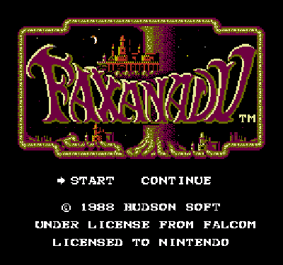
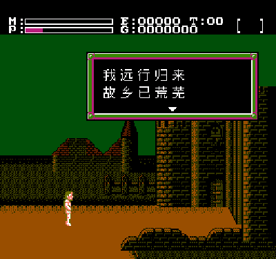
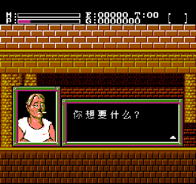
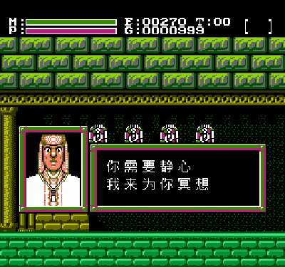

# Faxanadu 简体中文汉化版

本汉化以美版《Faxanadu (U)》为底本，日版文本用于对照校译；目前已完成全部剧情文本的简体中文初翻、12×12 中文字库和双字节文本渲染。

## 目录

- [汉化内容](#汉化内容)
- [游戏截图](#游戏截图)
- [技术实现](#技术实现)
- [修改内容](#修改内容)
- [构建与验证](#构建与验证)
- [版权信息](#版权信息)
- [致谢](#致谢)
- [相关链接](#相关链接)

## 汉化内容

本分支完成剧情对话汉化

- **194 条文本**：引擎扫描表内 193 条消息 + 1 条商店欢迎语，全部写入 bank 13。
- **583 个字形（12×12 墨迹窗口）**：由 Fusion Pixel 12px 等宽 BDF 字体生成，24 B/字形，共 13,992 B。
- **专用双字节编码**：`$80+` 引导全角字符，保留原版 `$FB`–`$FF` 控制码；`script_codec.py` 负责编码、解码与往返校验。
- **两行分页对话框**：由原版四行半角改为每页两行、每行 8 个全角字；满页后等待玩家按 A 翻页。
- **全角 2×2 tile 渲染**：一个汉字占 2×2 个 8×8 tile，写入 `$1400`–`$17FF` 的滚动 CHR 页。
- **原版半角路径保留**：菜单、道具名等原版 UI 仍走 `UI_DrawString`，对话框中的 ASCII 仍走 `TextBox_WriteChar`。
- **译名统一**：Eolis→埃奥利斯、Apolune→阿波伦、Forepaw→福尔波、Mascon→马斯康、Dartmoor→达特穆尔、World Tree→世界树、Guru→神父、Golds→金币。

## 游戏截图

| 标题画面 | 开场剧情 |
| :---: | :---: |
| [](title.png) | [](intro.png) |

| 商店对话 | 神父对话 |
| :---: | :---: |
| [](shop.png) | [](guru.png) |

## 技术实现

### 文本编码

| 字节 | 含义 |
| --- | --- |
| `$20`–`$7E` | ASCII 半角字符，原版路径，占 1 个 tile 列 |
| `$80`–`$FA` | 全角首字节：bit7 置 1，低 7 位为字形号的高 7 位；下一字节为字形号的低 8 位 |
| `$FB` | 玩家称号插入（`[title]`） |
| `$FC` | 暂停 |
| `$FD` | 空格 |
| `$FE` | 换行 |
| `$FF` | 消息结束 |

编码公式为 `b1 = $80 | (字形号 >> 8)`、`b2 = 字形号 & $FF`。`$FB`–`$FF` 优先按原版控制码处理，因此全角首字节实际可用范围是 `$80`–`$FA`；当前 583 个字形只用到 `$80`–`$82`。

- 字形号就是 `hanhua/text/chars_zh.txt` 的行序（从 0 开始）；`script_codec.py rebuild` 会按译文重新排表，`apply` 再重编码全部消息。不要手改 `chars_zh.txt`。
- 同一条消息不能混用全角与半角：半角写入器使用不同的 CHR 页公式，混排会把字符画到另一行的页面。译文统一走全角路径，原版 UI 仍走半角路径。
- 字形号的低字节不能是 `$FF`，否则会被消息扫描当成结束符；`rebuild` 会在这些索引上放占位字形，避免消息被截断。

### 字形与渲染

- 字形来自 [Fusion Pixel 12px](https://github.com/TakWolf/fusion-pixel-font)，取 12×12 墨迹窗口；每个字形 12 行 × 2 字节 = 24 B，1bpp 紧凑存储。
- 显示时占 2×2 个 8×8 tile（16×16 像素单元），写入 4 个 CHR tile；渲染器把同一 8 字节写两遍作为 plane0/plane1，得到调色板颜色 3（对话框中的白色）。
- 文本 CHR 使用 `$1400`–`$17FF` 的 4 个滚动页；一个全角行占两页。
- 字形整体上移 5 行，使 12×12 中文与原版 8×8 HUD 字体共享基线；菜单光标偏移保持原版的 `-32`，不再为中文额外补偿。

### 对话框分页

- 一行 = 16 个 tile 列 = 8 个全角字；一页 = 2 行。
- 满两行后暂停，显示下箭头；按 A 翻页，打字继续。
- 翻页时先清空 `$1400`–`$17FF`（1024 B），再从第 0 行开始排版，避免上一页第二行残留。
- 全角字符从 bank 15 的 `ZHV_FullWidthEntry` 进入：先读取消息流中的第二个字节，再切换到 bank 9 的 `ZHV_DrawFullWidthChar`；返回时由固定 bank 的 `ZHV_FullWidthDone` 切回原 bank，避免在切换后的窗口继续取指。

### 存储布局

| Bank | 内容 |
| --- | --- |
| 9 | 583 个字形 + `PRG9_code.asm`（全角渲染、翻页清屏） |
| 13 | 193 条消息 + 商店欢迎语 |
| 15 | 固定 bank：全角入口 / 返回 stub、对话框分页控制、`END_OF_ROM` 中断向量 |
| 0–8、10–12 | 原版数据；PRG4/PRG12 仅注释与说明调整 |
| 14 | 原版数据 + `CastMagic` 地址符号化修复（PRG14） |

- bank 9 在原版中整块为 `$FF`（`BANK_9_UNUSED`），汉化把字库和渲染器放在这里，不挤占原版数据。
- 整卡仍为 **256 KiB**：16 × 16 KiB PRG，bank 15 是文件最后一个 bank，由 MMC1 映射到 `$C000`–`$FFFF`，不再需要固定 bank 的镜像副本。
- iNES 1.0 头：Mapper 1、16 个 PRG 单元、CHR 0（使用 8 KiB CHR RAM）。
- 全角入口/返回 stub 放在固定 bank 15 末尾的 `$FF` 填充区（约 48 B 余量），不挤动原有代码和分支距离。
- `ZHV_*` 四个临时变量固定在 `$07A0`–`$07A3`：`ld65.cfg` 的 RAM 区域声明为 `$0100`–`$08FF`，比 NES 实际 RAM 多 256 B，链接器直接分配会落到 `$0800+`。

## 修改内容

### 汉化工具与文本

| 文件 | 说明 |
| --- | --- |
| [`hanhua/textscn.tsv`](hanhua/textscn.tsv) | 唯一手改译文源，194 条文本 |
| [`hanhua/text/chars_zh.txt`](hanhua/text/chars_zh.txt) | 583 字用字表（由 `rebuild` 生成） |
| [`hanhua/bdf.py`](hanhua/bdf.py) | 最小 BDF 读取器（`font_gen.py` / `script_codec.py` 的依赖） |
| [`hanhua/font_gen.py`](hanhua/font_gen.py) | BDF → `src/PRG9.asm` 字库生成器 |
| [`hanhua/export_symbols.py`](hanhua/export_symbols.py) | 导出 `build/symbols.tsv`、常量表与数据表（`make symbols`） |
| [`hanhua/export_records.py`](hanhua/export_records.py) | 导出复合记录表 `build/data_records.tsv` |
| [`hanhua/script_codec.py`](hanhua/script_codec.py) | 文本 ↔ 消息字节编解码、`rebuild` / `apply` / `verify` |
| [`hanhua/check_message_load.py`](hanhua/check_message_load.py) | 复刻 `Messages_Load` 线性扫描，校验 193 条消息起点 |
| [`hanhua/text/messages_en.txt`](hanhua/text/messages_en.txt) | 美版 193 条原文抽取 |
| [`hanhua/text/messages_jp.txt`](hanhua/text/messages_jp.txt) | 日版 193 条原文抽取 |
| [`hanhua/text/chars_jp.txt`](hanhua/text/chars_jp.txt) | 日版 16×16 字库码表 |
| [`hanhua/text/ui_text_en.txt`](hanhua/text/ui_text_en.txt) | UI 英文底稿（生成） |
| [`hanhua/text/ui_text_zh_draft.txt`](hanhua/text/ui_text_zh_draft.txt) | UI 中文初稿（未接入 ROM） |

## 构建与验证

### 所需工具

- cc65
- GNU make
- Python3

### 构建 ROM

```bash
git switch hanhua
make
```

产物：`build/faxanadu.nes`

### 重新生成译文

修改 `hanhua/textscn.tsv` 后：

```bash
make translate
```

`make translate` 的顺序不能调换：

```text
hanhua/textscn.tsv
  → script_codec.py rebuild   → hanhua/text/chars_zh.txt
  → font_gen.py               → src/PRG9.asm
  → script_codec.py apply     → src/PRG13.asm
  → make                      → build/faxanadu.nes
  → make symbols              → build/symbols.tsv
  → script_codec.py verify    → 逐条往返校验
  → check_message_load.py     → 193 条消息起点校验
```

## 版权信息

### 原版游戏

美版标题画面原文：

```text
© 1988 HUDSON SOFT
UNDER LICENSE FROM FALCOM
LICENSED TO NINTENDO
```

Faxanadu 的游戏本体、角色、图形、音乐与文本版权归 Hudson Soft 及其权利继受方 Konami Digital Entertainment、以及 Nihon Falcom 所有。

### 反汇编

本分支基于 chipx86 的 [Faxanadu 反汇编](https://github.com/chipx86/faxanadu)。反汇编及其注释的版权归原作者所有；使用请遵循上游仓库的说明。

### 免责声明

本项目仅供学习、研究与个人汉化交流，请勿用于销售、付费下载或其他商业用途。

## 致谢

- [chipx86](https://github.com/chipx86) —— Faxanadu 完整反汇编与注释
- [Fusion Pixel Font](https://github.com/TakWolf/fusion-pixel-font) —— 12px 中文点阵字形
- [NESdev Wiki](https://www.nesdev.org/) —— iNES / MMC1 技术资料
